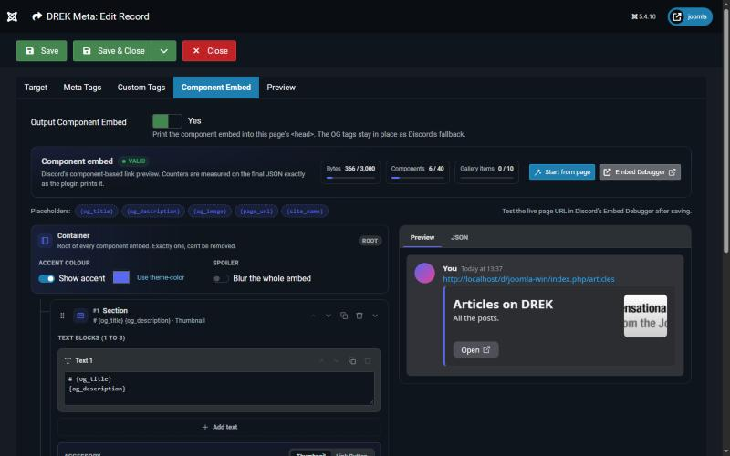
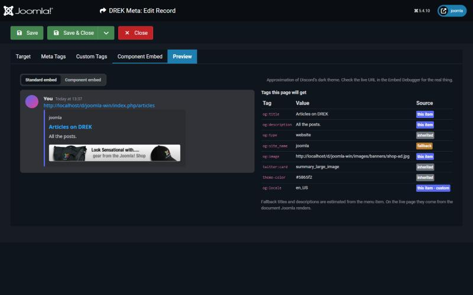

<div align="center">

# DREK Meta

**Control how your Joomla pages unfurl in Discord, X and everywhere else.**

Per-menu-item Open Graph, Twitter Card, `theme-color` and custom meta tags,
plus a visual builder for Discord's new **Component Embeds**.

[](https://www.joomla.org/)
[](https://www.php.net/)
[](https://www.gnu.org/licenses/old-licenses/gpl-2.0.html)

[**Download**](../../releases/latest) · [Features](#features) · [Install](#install) · [Component embeds](#discord-component-embeds) · [How it works](#how-it-works)



</div>

---

## Why

Joomla core gives you a meta description and robots per menu item. That's it. No `og:image`, no `theme-color`, and definitely no Discord component embeds, so links to your site unfurl as whatever the template happens to guess. DREK Meta fixes that, per page, from one admin screen.

## Features

- 🏷️ **Meta tags per menu item**: `og:title`, `og:description`, `og:image` (+ alt, auto width/height), `og:type`, `og:site_name`, `twitter:card`, `theme-color`
- 🌍 **Global defaults** that every page inherits field by field, so you only override what's different
- ➕ **Custom tags**: any `name` / `property` / `http-equiv` tag, reorderable, overrides presets with the same key
- 🧱 **Discord Component Embed builder**: containers, sections, text, thumbnails, media galleries, separators and link buttons, with drag-and-drop
- 📏 **Live limits**: bytes, components and gallery items, measured on the *exact* JSON the plugin prints
- 🔍 **Previews** that look like Discord, for both the standard OG card and the component embed, plus a table showing where every tag's value comes from
- 🧩 **Placeholders** like `{og_title}` and `{page_url}`, so one layout works on every page
- 🛡️ **Validated three times** (browser, save, render). A broken embed never reaches the page; the OG tags stay as the fallback.
- 🔄 **One-click updates** through Joomla's own updater, straight from this repo's releases (checksum-verified)
- 🧹 **Clean uninstall**: removes everything, including the table

<div align="center">

</div>

## Requirements

| | |
|---|---|
| Joomla | 5.x or 6.x (built to also run on 4.4) |
| PHP | 8.1+ |
| Database | MySQL / MariaDB, PostgreSQL |

## Install

1. Grab `pkg_drekmeta-x.y.z.zip` from the [latest release](../../releases/latest).
2. In Joomla: **System → Install → Extensions → Upload Package File**.
3. Open **Components → DREK Meta**.

The package installs the admin component and the system plugin, switches the plugin on, and creates the **Global defaults** record.

> [!TIP]
> Prefer the CLI? `php cli/joomla.php extension:install --path=/path/to/pkg_drekmeta-x.y.z.zip`

### Updates

You only install by hand once. After that, new releases show up in Joomla like any other extension update: **System → Update → Extensions**, tick **DREK Meta**, click **Update**. Your records and settings are kept.

The update server is this repo's latest release (`releases/latest/download/updates.xml`). Joomla verifies the download against the SHA-256 in that file before installing, and only stable releases are offered (prereleases never become "latest").

> [!NOTE]
> **v1.0.0** shipped before the update server existed, so a site on 1.0.0 needs one manual install of a newer release. Every version after that updates itself.

## Usage

### 1. Set the global defaults

The first row in the list, **Global defaults (all pages)**, applies to every page. Give it at least an image and a colour. It can't be deleted or unpublished.

### 2. Override per menu item

Click **New**, pick a menu item and fill in only what should be different. Empty fields inherit from the global defaults; the field placeholders tell you what they'll inherit.

| Tab | What's in it |
|---|---|
| **Target** | Menu item (one record each), admin label that fills itself in |
| **Meta Tags** | og:title, og:description (with char/byte counter), og:image + alt, og:type, og:site_name, twitter:card, theme-color |
| **Custom Tags** | Extra `<meta>` rows: attribute, key, value |
| **Component Embed** | The builder (see below) |
| **Preview** | Discord-style standard / component embed, plus the full tag list with sources (*this item*, *inherited*, *fallback*, *custom*) |

### 3. Check it

View the page source, or ask like Discord does:

```powershell
curl.exe -s -A "Discordbot/2.0" https://your-site.example/some-page | Select-String 'og:|twitter:|theme-color|discord:'
```

Then drop the URL into Discord's [Embed Debugger](https://discord.com/developers/embeds). When pasting into Discord itself, add `?v=2` (bump it each time) to get past Discord's ~30 minute cache.

## Discord Component Embeds

[Component embeds](https://docs.discord.com/developers/link-previews/component-embeds) let a page describe its own Discord preview with real components instead of a plain OG card. DREK Meta builds the payload visually and prints it into `<head>`:

```html
<script id="discord:component-embed" type="application/json">{"component":{"type":17,…}}</script>
```

**The builder**

- A fixed root **Container** (accent colour defaults to your theme-color, optional spoiler)
- **Text Display**, **Section** (1 to 3 texts + a thumbnail *or* link button), **Media Gallery**, **Separator**, **Buttons** (up to 5 link buttons)
- Drag or arrow to reorder, duplicate, delete, collapse
- **Pick** images and videos straight from Joomla's media manager
- **Start from page** gives you a ready-made layout: title + description + thumbnail, and an *Open* button
- **JSON tab**: edit the raw payload, import a `.json`, copy it, or view the final resolved output

**Placeholders** work in any text or URL field and are filled in per page at render time:

| Placeholder | Becomes |
|---|---|
| `{og_title}` | The page's final og:title |
| `{og_description}` | The page's final og:description |
| `{og_image}` | The absolute og:image URL |
| `{page_url}` | The current page URL |
| `{site_name}` | og:site_name, or the site name |

**Limits** (enforced live, on save, and again when the page renders):

| Rule | Limit |
|---|---|
| Payload size, measured *after* encoding (escapes count) | 3,000 bytes |
| Components, Container included | 40 |
| Media gallery items across the whole embed | 10 |
| Buttons | link style (`5`) only; keys limited to `id type url style label emoji disabled` |
| Media URLs | http(s), ≤ 2,048 chars, png / gif / jpg / jpeg / webp / avif (gallery also mp4 / webm / mov) |
| Button labels / alt text | 80 / 1,024 characters |

> [!IMPORTANT]
> Discord drops the **whole** embed if a button has a key it doesn't know. Unknown keys on other components are stripped silently, but extra button keys block saving, so you find out in the admin and not in Discord.

If an embed is invalid or too big at render time (say, a placeholder resolves to something too long on one page), the plugin prints nothing for it, keeps the OG tags, and logs why to `administrator/logs/drekmeta.php`.

## How it works

On every site HTML page, `plg_system_drekmeta` hooks `onBeforeCompileHead` and:

1. Finds the active menu item. With **Exact Menu Item Pages Only** on, a record only applies when the page *is* that menu item. An article opened from a blog gets the global defaults, not the blog's title.
2. Loads the global and the item record in one query (published only, cached per request).
3. Merges them field by field. `og:image:alt` follows whichever record supplied the image.
4. Fills gaps from the document title / meta description / site name (configurable).
5. Strips `og:*` / `twitter:*` tags others added (configurable), then writes its own: `property=` for OG, `name=` for `twitter:*` and `theme-color`, mirroring title, description and image to Twitter tags.
6. Applies custom tags last, so they win.
7. Resolves, re-validates and prints the component embed, for **every** visitor (not only Discordbot) so page caching can't serve the wrong variant.

Nothing here ever throws on the frontend. Errors are caught and logged, and disabling the plugin puts the page back exactly as it was.

## Options

**Components → DREK Meta → Options**

| Option | Default | What it does |
|---|:---:|---|
| Remove Existing OG/Twitter Tags | ✅ | Strip tags the template or other extensions added |
| Output og:url | ✅ | Add the current URL as `og:url` |
| Title Fallback | ✅ | Use the document title when no og:title is set |
| Description Fallback | ✅ | Use the meta description when no og:description is set |
| Exact Menu Item Pages Only | ✅ | See step 1 above |
| Discord Component Embeds | ✅ | Master switch for every component embed |

Plus standard Joomla **Permissions**.

## Uninstall

Uninstall **pkg_drekmeta** under **System → Manage → Extensions**. The component, plugin, media, language files, update site and the `#__drekmeta_items` table are all removed. Only `administrator/logs/drekmeta.php` stays, if anything was ever logged.

## Known limits

- The builder estimates fallback titles and descriptions from the menu item. If a component sets a different title at runtime and you use `{og_title}` without setting og:title, the live byte count can differ a little. Set og:title, or check the live page.
- The global record's embed is validated on save against the home page. On other pages it's re-validated at render time and skipped (and logged) if it doesn't fit there.
- The external `<link rel="discord:component-embed">` variant isn't supported yet.
- Discord's link previews are officially "subject to change". The Embed Debugger is the source of truth.

## License

[GPL-2.0-or-later](LICENSE). Made by [drek124](https://github.com/drek124).
